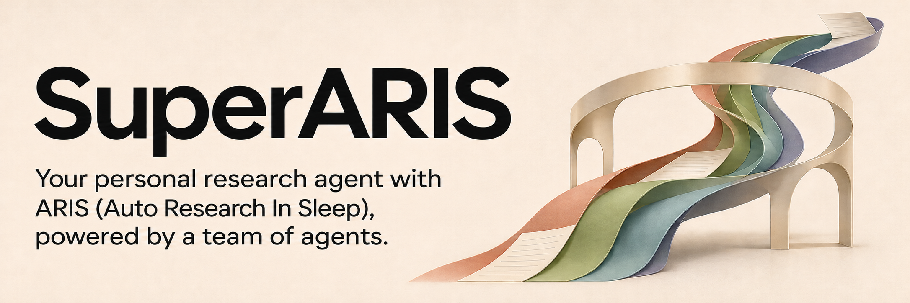
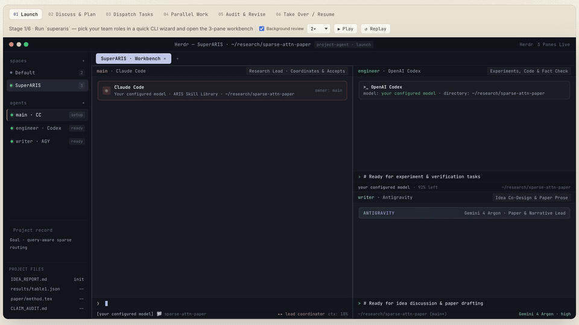

[](https://wanshuiyin.github.io/SuperARIS/)

**SuperARIS — Your personal research agent with ARIS (Auto Research In Sleep, ~20k stars), powered by a team of agents.**

[](https://wanshuiyin.github.io/SuperARIS/) [](https://github.com/wanshuiyin/Auto-claude-code-research-in-sleep) [](#cite-aris)

[简体中文](README_CN.md) · **v0.1.0 preview** · [Install](#install-and-open) · [Guides](#guides) · [MIT](LICENSE)

[](https://wanshuiyin.github.io/SuperARIS/media/demo-en.mp4)

**[▶ Watch the full 1080p demo · ≈21 seconds](https://wanshuiyin.github.io/SuperARIS/media/demo-en.mp4)**

*Animated preview · click to play the full video. Illustrative project and data.*

Discuss a research goal with your personal agent. It organizes a persistent team, delegates work, checks incoming results, and keeps track of what should happen next. Join any teammate's session to explore an idea, refine a draft, or take over.

Built on [ARIS](https://github.com/wanshuiyin/Auto-claude-code-research-in-sleep) (Auto Research In Sleep, ~20k GitHub stars), SuperARIS equips each role with the research workflows and project context it needs. The team works within one project, with clear responsibilities and a record you can return to tomorrow.

## One personal agent, a persistent team

Your main agent holds the research direction and coordinates the work. Codex can implement experiments and check evidence; Gemini can discuss the argument and write substantial paper sections. Each collaborator has its own ongoing session, so you can work directly with the teammate you need and continue the discussion where you left off.

Start with Codex alone, add a Claude Code main agent with Codex engineering, or include an Antigravity writing role. Choose models through your own CLI configuration. Temporary MCP workers and fresh reviewers remain available alongside the persistent team.

## ARIS for every teammate

Each role receives its task, working area, ARIS navigation, and the relevant skills to read before acting. Ask the main agent to run a complete pipeline, delegate a connected workflow, or use one skill for a focused task.

| What you need | ARIS entry |
|---|---|
| Carry a research project from idea to paper | [research-pipeline](https://github.com/wanshuiyin/Auto-claude-code-research-in-sleep/blob/main/skills/research-pipeline/SKILL.md) |
| Develop and test a research direction | [idea-discovery](https://github.com/wanshuiyin/Auto-claude-code-research-in-sleep/blob/main/skills/idea-discovery/SKILL.md) |
| Implement the experiment plan and collect results | [experiment-bridge](https://github.com/wanshuiyin/Auto-claude-code-research-in-sleep/blob/main/skills/experiment-bridge/SKILL.md) |
| Review, revise, and check the research again | [auto-review-loop](https://github.com/wanshuiyin/Auto-claude-code-research-in-sleep/blob/main/skills/auto-review-loop/SKILL.md) |
| Turn checked findings into a paper | [paper-writing](https://github.com/wanshuiyin/Auto-claude-code-research-in-sleep/blob/main/skills/paper-writing/SKILL.md) |

These use your configured tools and keep ARIS's review and acceptance criteria. [Skills and project context →](docs/PROJECT_CONTEXT.md)

## Follow up on the work

SuperARIS tracks registered tasks, result files, and reports while the original main session is running—even after you close the workbench window. Your main agent uses those updates to collect finished work, check the evidence, and continue the next authorized step.

Human-controlled sessions receive notices; dedicated Codex sessions can use automatic follow-up. [Receiving results and continuing work →](docs/RESULTS_AND_MEMORY.md)

## Long-term project memory

Keep the project's goals, decisions, corrections, results, and next actions in its existing notes and research wiki. Agents update these records as the work progresses and read them back when resuming. The context stays with the project across days and sessions, in files you can inspect and edit.

Reopen a running team to continue its conversations, or give a new session the project's recovery entry. [Context and recovery →](docs/PROJECT_CONTEXT.md)

## Install and open

Requires Python 3.10+ on macOS or Linux, [Herdr](https://herdr.dev), and your chosen native CLIs (`codex`, `claude`, `agy`) with model access configured.

```bash
pipx install 'git+https://github.com/wanshuiyin/SuperARIS.git'
superaris
```

Choose the interface language, project, team, and models, then confirm the workspace. Give the main agent a task, or open the team and discuss what to do next. The interface language is independent of your paper or task language.

| Team | Persistent roles |
|---|---|
| Codex | Codex main agent |
| Claude Code + Codex | Main agent and engineering collaborator |
| Claude Code + Codex + Antigravity | Main agent, engineering, and writing collaborator |

SuperARIS obtains its pinned ARIS resources when needed. Existing ARIS installations and custom skills can be used through the documented source selection. [Dependencies and updates →](docs/DEPENDENCIES.md)

<details>
<summary>Other installation options and an existing ARIS checkout</summary>

Local wheel (including offline installation):

```bash
python3 -m pip install --no-index --no-deps /path/to/superaris-0.1.0-py3-none-any.whl
python3 -m superaris
```

Checkout in an isolated environment:

```bash
git clone https://github.com/wanshuiyin/SuperARIS.git
cd SuperARIS
python3 -m venv .venv
.venv/bin/python -m pip install .
.venv/bin/superaris
```

Select an existing ARIS source explicitly:

```bash
SUPERARIS_ARIS_REPO=/path/to/aris superaris
```

Help, plans and wizard cancellation do not fetch ARIS. See [source selection](docs/DEPENDENCIES.md) for the fixed revision, local cache and existing receiver compatibility.

</details>

## Guides

- [Workbench, roles, and human handoff](docs/WORKBENCH.md)
- [Skills, context, and recovery](docs/PROJECT_CONTEXT.md)
- [Follow-up and project memory](docs/RESULTS_AND_MEMORY.md)
- [ARIS source, dependencies, and updates](docs/DEPENDENCIES.md)

## Cite ARIS

SuperARIS builds on ARIS's research workflows, review mechanisms, and project knowledge. If you use this foundation in your research, please cite the [ARIS technical report](https://arxiv.org/abs/2605.03042):

```bibtex
@article{yang2026aris,
  title={ARIS: Autonomous Research via Adversarial Multi-Agent Collaboration},
  author={Yang, Ruofeng and Li, Yongcan and Li, Shuai},
  journal={arXiv preprint arXiv:2605.03042},
  year={2026}
}
```

Thanks to [ARIS](https://github.com/wanshuiyin/Auto-claude-code-research-in-sleep) for the research foundation and [Herdr](https://herdr.dev) for the persistent native sessions. SuperARIS is [MIT licensed](LICENSE); source attribution is preserved in [NOTICE](NOTICE).
