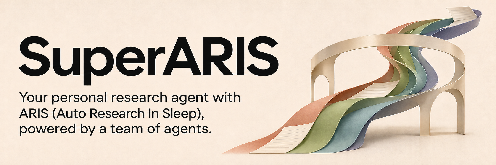
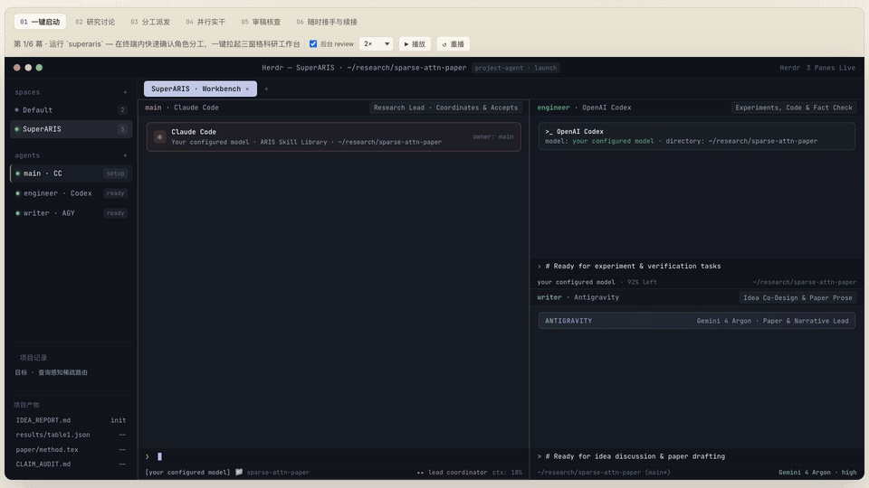

[](https://wanshuiyin.github.io/SuperARIS/)

**SuperARIS — Your personal research agent with ARIS (Auto Research In Sleep, ~20k stars), powered by a team of agents.**

**你的个人科研 Agent，基于 ARIS，由一支常驻 Agent 团队协作推进。**

[](https://wanshuiyin.github.io/SuperARIS/) [](https://github.com/wanshuiyin/Auto-claude-code-research-in-sleep) [](#cite-aris)

[English](README.md) · **v0.1.0 预览版** · [安装](#安装与启动) · [使用文档](#使用文档) · [MIT](LICENSE)

[](https://wanshuiyin.github.io/SuperARIS/media/demo-zh.mp4)

**[▶ 播放完整 1080p 中文演示 · 约21秒](https://wanshuiyin.github.io/SuperARIS/media/demo-zh.mp4)**

*动图预览，点击播放高清完整版。示例项目与数据。*

和你的个人 Agent 讨论科研目标，让它组织团队、分配工作、核验成果，并跟进下一步。想深入讨论一个想法、共同修改一段正文，或亲自接手时，直接进入相应成员的会话。

SuperARIS 基于 [ARIS](https://github.com/wanshuiyin/Auto-claude-code-research-in-sleep)（Auto Research In Sleep，约 2 万 GitHub stars），为每个角色提供所需的科研流程与项目上下文。团队围绕同一个项目持续协作，分工清楚，研究记录随项目保存，明天回来还能接着做。

## 一个个人 Agent，一支持续协作的团队

主 Agent 把握研究方向、组织分工并回收成果。Codex 可以实现实验与核查证据，Gemini 可以共同讨论立意、组织论证并主写论文正文。每个成员都有自己的常驻会话，你可以直接与它共创，让讨论接着已有上下文继续。

可以先用 Codex 独立工作，再按需要选择 Claude Code 主控与 Codex 工程组合，或加入 Antigravity 写作角色。实际模型沿用你的 CLI 配置；临时 MCP worker 和需要全新上下文的独立 reviewer 继续在后台协作。

## 每个成员都能使用 ARIS

各角色拿到自己的任务、工作范围、ARIS 导航和所需技能，在执行时读取相应流程。你可以让主 Agent 推进完整科研 pipeline，把一段 workflow 委派给协作者，也可以只调用一个 skill 处理眼前的问题。

| 你想做什么 | ARIS 入口 |
|---|---|
| 从研究方向推进到论文 | [research-pipeline](https://github.com/wanshuiyin/Auto-claude-code-research-in-sleep/blob/main/skills/research-pipeline/SKILL.md) |
| 寻找、筛选并验证研究想法 | [idea-discovery](https://github.com/wanshuiyin/Auto-claude-code-research-in-sleep/blob/main/skills/idea-discovery/SKILL.md) |
| 实现实验计划并收集结果 | [experiment-bridge](https://github.com/wanshuiyin/Auto-claude-code-research-in-sleep/blob/main/skills/experiment-bridge/SKILL.md) |
| 迭代审阅、修订和复核 | [auto-review-loop](https://github.com/wanshuiyin/Auto-claude-code-research-in-sleep/blob/main/skills/auto-review-loop/SKILL.md) |
| 将核验过的成果写成论文 | [paper-writing](https://github.com/wanshuiyin/Auto-claude-code-research-in-sleep/blob/main/skills/paper-writing/SKILL.md) |

这些流程使用你已配置的工具，并保留 ARIS 原有的审阅和验收要求。[技能与项目上下文 →](docs/PROJECT_CONTEXT.md)

## 主动跟进工作

项目运行期间，SuperARIS 跟踪已登记的任务、结果文件和交付报告。原主会话仍在运行时，关闭工作台窗口也不打断跟进。主 Agent 根据这些更新收回完成的工作、核对证据，再推进下一项已授权步骤。

人工掌控的会话通过通知收件；专门交给自动化的 Codex 会话可以自动接收后续提示。[收件与工作接续 →](docs/RESULTS_AND_MEMORY.md)

## 长期项目记忆

目标、决定、纠正、结果和下一步，保存在项目原有的笔记与 research wiki 中。Agent 随工作更新这些记录，恢复时重新读回。研究上下文跨天、跨会话留在项目里，你也可以直接查看和修改这些文件。

原团队仍在运行时，重新打开即可继续对话；换一个新会话，也能从项目恢复入口接上已有工作。[上下文与恢复 →](docs/PROJECT_CONTEXT.md)

## 安装与启动

需要 Python 3.10+、macOS 或 Linux、[Herdr](https://herdr.dev)，以及配置好模型访问的所选原生 CLI（`codex`、`claude`、`agy`）。

```bash
pipx install 'git+https://github.com/wanshuiyin/SuperARIS.git'
superaris
```

选择界面语言、项目、团队和模型，确认后进入工作台。可以直接给主 Agent 一个任务，也可以先打开团队，再讨论要做什么。界面语言与论文、任务语言分别选择。

| 团队组合 | 常驻角色 |
|---|---|
| Codex | Codex 主 Agent |
| Claude Code + Codex | 主 Agent 与工程协作者 |
| Claude Code + Codex + Antigravity | 主 Agent、工程与写作协作者 |

SuperARIS 在需要时获取固定版本的 ARIS 资源；已有 ARIS 源码和定制技能可按文档选择来源。[依赖与更新 →](docs/DEPENDENCIES.md)

<details>
<summary>其它安装方式与已有 ARIS 源码</summary>

安装本地 wheel（也适用于离线安装）：

```bash
python3 -m pip install --no-index --no-deps /path/to/superaris-0.1.0-py3-none-any.whl
python3 -m superaris
```

在独立环境中从源码安装：

```bash
git clone https://github.com/wanshuiyin/SuperARIS.git
cd SuperARIS
python3 -m venv .venv
.venv/bin/python -m pip install .
.venv/bin/superaris
```

明确选择已有 ARIS 源码：

```bash
SUPERARIS_ARIS_REPO=/path/to/aris superaris
```

帮助、计划预览和向导取消不会获取 ARIS。固定版本、本地缓存与已有 receiver 的兼容说明见[依赖与来源](docs/DEPENDENCIES.md)。

</details>

## 使用文档

- [工作台、角色与人工接手](docs/WORKBENCH.md)
- [技能、上下文与恢复](docs/PROJECT_CONTEXT.md)
- [主动跟进与项目记忆](docs/RESULTS_AND_MEMORY.md)
- [ARIS 来源、依赖与更新](docs/DEPENDENCIES.md)

## Cite ARIS

SuperARIS 基于 ARIS 的科研流程、审阅机制与项目知识积累。如果这些能力帮助了你的研究，请引用 [ARIS 技术报告](https://arxiv.org/abs/2605.03042)：

```bibtex
@article{yang2026aris,
  title={ARIS: Autonomous Research via Adversarial Multi-Agent Collaboration},
  author={Yang, Ruofeng and Li, Yongcan and Li, Shuai},
  journal={arXiv preprint arXiv:2605.03042},
  year={2026}
}
```

感谢 [ARIS](https://github.com/wanshuiyin/Auto-claude-code-research-in-sleep) 提供科研底座，[Herdr](https://herdr.dev) 提供常驻原生会话。SuperARIS 使用 [MIT 许可](LICENSE)，源码归属见 [NOTICE](NOTICE)。
